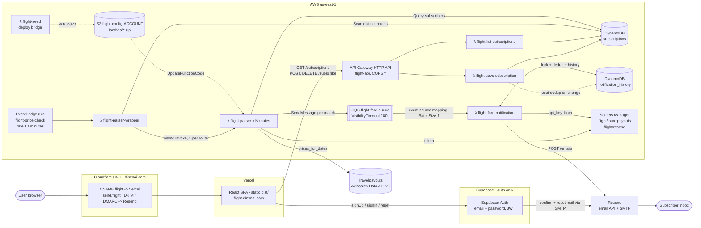
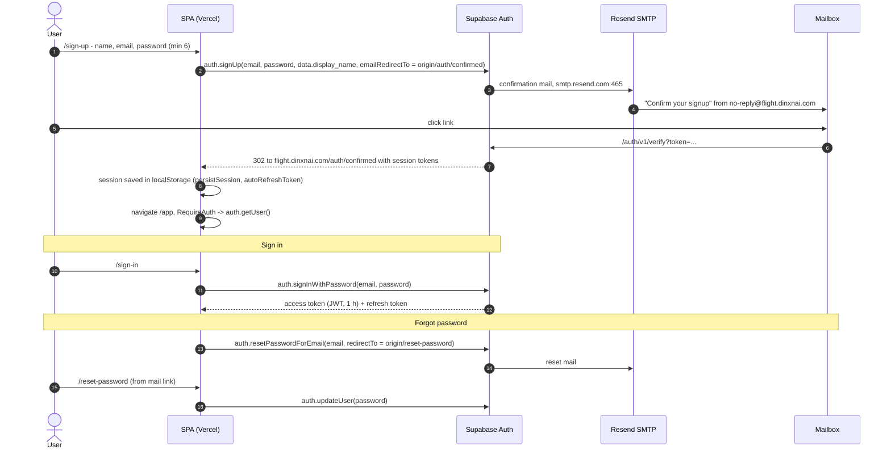
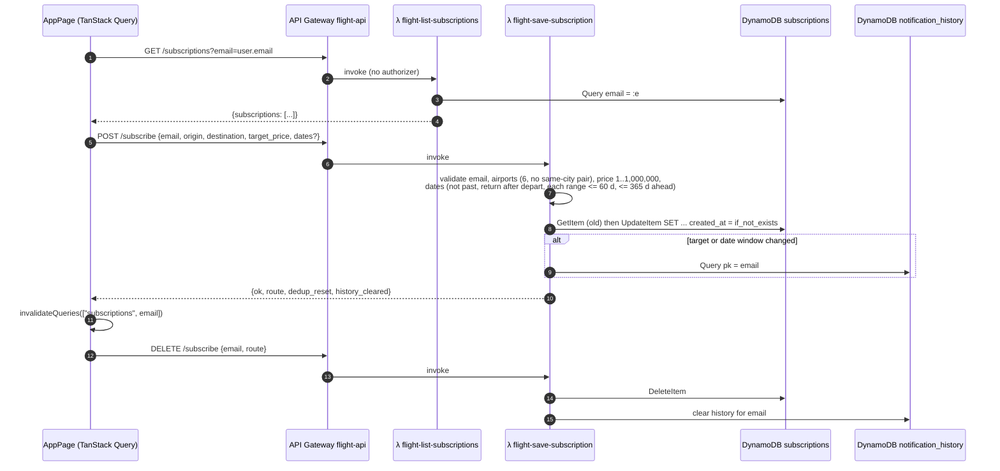
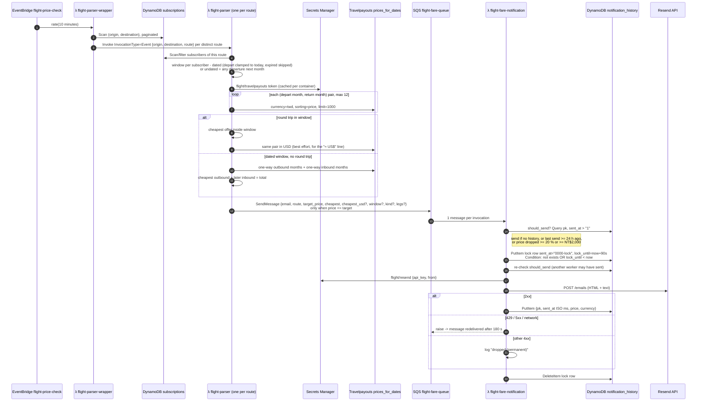
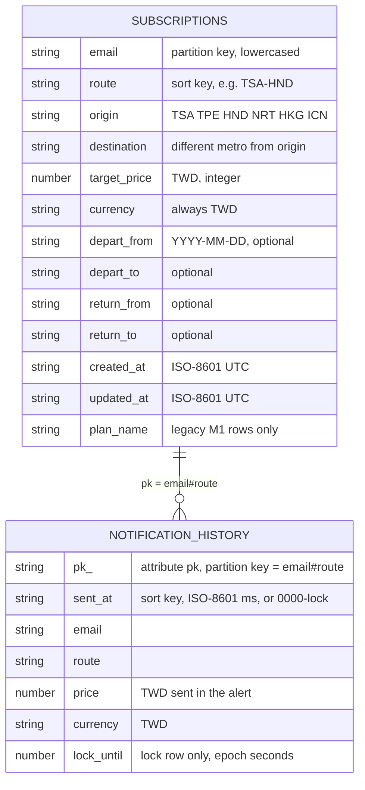
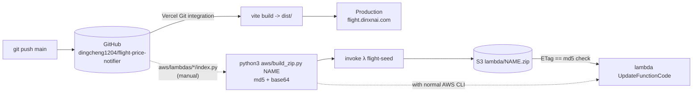

# Flight Price Notifier ✈️

設定航線與目標價，機票降價就通知你 — pick a route and a target price, get an email when the fare drops.

**Live:** <https://flight.dinxnai.com>

A small full-stack project: a React single-page app on Vercel, Supabase for sign-in, and a serverless AWS backend (API Gateway, Lambda, DynamoDB, SQS, EventBridge) that polls cached fares from Travelpayouts every 10 minutes and emails subscribers through Resend.

---

## Features

- **Route alerts between six airports**: Taipei Songshan (TSA), Taipei Taoyuan (TPE), Tokyo Haneda (HND), Tokyo Narita (NRT), Hong Kong (HKG), and Seoul Incheon (ICN), in both directions. You can't create a route between two airports in the same city.
- **Target price in TWD**: you get an alert when the cheapest round trip is at or below your target.
- **Optional date windows** ("指定日期", on by default): a departure range plus a return range, each up to 60 days. When dates are off, the alert watches any departure next month.
- **One-way fallback**: if no round trip is cached for your window, the backend adds up the two cheapest one-way legs (outbound, then a later inbound) and alerts on that total.
- **No inbox flooding**: each route sends at most one email per 24 h, unless the price drops another 20 % or NT$2,000.
- **Accounts**: email + password sign-up with email confirmation, sign-in, and password reset (Supabase Auth).
- **Bilingual UI** (Traditional Chinese / English), responsive layout, and an original sky-scene theme.

## Architecture

> Detailed diagrams below; a full review of services, tools, third parties, and recommendations (Traditional Chinese) is in [`docs/PROJECT-REVIEW.md`](docs/PROJECT-REVIEW.md).

### System overview



### Sign-up, sign-in, and password reset (Supabase)



Supabase stores **only** the `auth.users` rows; the `public` schema is empty. Site URL and the redirect allowlist (`https://flight.dinxnai.com/**`) are set in _Authentication → URL Configuration_.

### Managing alerts (`/app` → API → DynamoDB)



### Price polling and notification (every 10 minutes)



### DynamoDB data model

Both tables are on-demand (`PAY_PER_REQUEST`), no GSIs, no TTL.



| Table                  | Key                                   | Access patterns                                                                                                                                                    |
| ---------------------- | ------------------------------------- | ------------------------------------------------------------------------------------------------------------------------------------------------------------------ |
| `subscriptions`        | PK `email`, SK `route`                | Query by email (list page); GetItem/UpdateItem/DeleteItem by (email, route); Scan for distinct routes (wrapper) and per-route subscribers (parser)                 |
| `notification_history` | PK `pk` = `email#route`, SK `sent_at` | Query `sent_at > "1"` for history (skips the lock row, because `"0000-lock" < "1"`); conditional Put/Delete on `sent_at = "0000-lock"` for the per-route send lock |

### Build and deploy paths



There is no CI for the backend: Lambda deploys are manual, and the AWS resources themselves were created by hand (no CloudFormation/SAM/CDK/Terraform except the tiny `flight-seed` stack).

| Layer     | What it uses                                                                                                              |
| --------- | ------------------------------------------------------------------------------------------------------------------------- |
| Front end | Vite, React 19, React Router 7, TypeScript, Tailwind CSS v4, shadcn/ui (Radix), TanStack Query, react-day-picker, sonner  |
| Auth      | Supabase Auth. Supabase only handles sign-in; app data never goes there                                                   |
| API       | AWS HTTP API (API Gateway v2) → Python 3.12 Lambdas (128 MB, x86_64)                                                      |
| Data      | DynamoDB: `subscriptions`, `notification_history`                                                                         |
| Jobs      | EventBridge schedule → fan-out Lambda → SQS → notification Lambda                                                         |
| Fares     | [Travelpayouts / Aviasales Data API](https://support.travelpayouts.com/hc/en-us/articles/203956163) `v3/prices_for_dates` |
| Email     | [Resend](https://resend.com), sending from `alerts@flight.dinxnai.com` (SPF/DKIM/DMARC set up); also Supabase's SMTP      |
| Hosting   | Vercel (static SPA) with the domain on Cloudflare DNS                                                                     |

## How an alert happens

1. **Subscribe.** The `/app` page sends `POST /subscribe` with `{email, origin, destination, target_price, dates?}`. The Lambda checks the airports, the price, and the dates (no past dates, return after departure, each range ≤ 60 days, nothing more than 365 days ahead), then saves one row per _(email, route)_. If you change the target or the dates, that route's alert history is cleared, so the new settings start fresh.
2. **Poll.** Every 10 minutes EventBridge runs `flight-parser-wrapper`. It scans the `subscriptions` table for distinct routes and invokes `flight-parser` once per route, asynchronously.
3. **Price.** `flight-parser` collects the month pairs (departure month × return month) that the route's subscribers need, makes one Travelpayouts call per pair (at most 12 per run), and picks the cheapest offer inside each subscriber's window. If the price is at or below the target, it puts a message on SQS. It does a best-effort USD lookup of the same flight, which shows up as a "≈ US$" line in the email.
4. **Notify.** `flight-fare-notification` takes one message at a time. For each `email#route` it takes a lock row so parallel workers can't double-send, checks the history against the 24 h / 20 % / NT$2,000 rule, sends the email through Resend, and records the send only after Resend returns 2xx. A 429 or 5xx re-raises the error, so SQS delivers the message again.

> **About freshness:** Travelpayouts returns the cheapest tickets that Aviasales users found in the **last 48 hours**. It's a cache, not a live fare search. That's why polling more often than about 10 minutes adds little, and why some dates have no price.

## Repository layout

```
├── src/
│   ├── pages/            Index (landing), Auth, AuthConfirmed, ResetPassword, AppPage (/app)
│   ├── components/       DateRangeField (range picker), RequireAuth, RootLayout (+ 404 / error page), ui/ (shadcn)
│   ├── lib/flight-api.ts API client, airport list, route + date-window validation
│   ├── integrations/supabase/   Supabase client (auth only)
│   ├── assets/theme/     sky-scene.svg background, grain/ripple textures
│   ├── styles.css        theme tokens (Tailwind v4)
│   └── test/             Vitest + Testing Library
├── public/               favicon set (svg/ico/apple-touch/PWA icons), webmanifest
├── aws/
│   ├── lambdas/<name>/index.py   source of every Lambda
│   ├── tests/test_lambdas.py     backend tests (moto, no real AWS)
│   ├── build_zip.py              deterministic zip builder for deploys
│   └── README.md                 backend details and redeploy steps
├── docs/PROJECT-REVIEW.md  services, tools, recommendations, rebuild-from-zero guide (zh-TW)
├── .claude/skills/       course skills (M0 guide + checklist, Supabase rules)
├── vercel.json           SPA rewrites + build settings
└── index.html
```

## Front end

### Routes

| Path              | Page                                                              |
| ----------------- | ----------------------------------------------------------------- |
| `/`               | Landing page                                                      |
| `/sign-in`        | Sign in (and "forgot password")                                   |
| `/sign-up`        | Create account                                                    |
| `/auth/confirmed` | Landing page for the sign-up confirmation link; goes on to `/app` |
| `/reset-password` | Set a new password (target of the reset email)                    |
| `/app`            | My alerts. Requires sign-in; otherwise redirects to `/sign-in`    |
| `/auth`           | Legacy URL, redirects to `/sign-in`                               |

### The date picker

- The calendar shows one month at a time. The first click sets the start, the second sets the end, and a third click starts a new range. Clicking a day before the start moves the start.
- After you pick a start, days past _start + 59_ are greyed out, so a range covers at most 60 days counting both ends. The API enforces the same cap.
- The return range can't begin on or before the departure start. If you move the departure past an existing return range, the return range is cleared.

### Develop

Requires [Bun](https://bun.sh), or Node.js 20+ with npm.

```sh
bun install
bun run dev        # http://localhost:5173
bun run test       # Vitest
bun run lint
bun run build      # static output in dist/
bun run preview    # serve dist/ locally
```

Environment variables (Vite reads them at build time). For local development, copy the template and fill it in. `.env` is git-ignored:

```sh
cp .env.example .env
```

| Variable                        | Purpose                                                                                                          |
| ------------------------------- | ---------------------------------------------------------------------------------------------------------------- |
| `VITE_SUPABASE_URL`             | Supabase project URL                                                                                             |
| `VITE_SUPABASE_PUBLISHABLE_KEY` | Supabase publishable (anon) key. It ships to the browser, so never put a service-role key in a `VITE_*` variable |
| `VITE_FLIGHT_API_URL`           | Optional. Overrides the API Gateway base URL (defaults to the production API)                                    |

## Back end

All Lambda source is in [`aws/lambdas/`](aws/lambdas). See [`aws/README.md`](aws/README.md) for each function, the DynamoDB key design, the dedup lock, and how to redeploy.

```sh
pip install "moto[dynamodb,secretsmanager,sqs]" boto3 pytest
python3 -m pytest aws/tests -q
```

### API

Base URL: `https://vs9im442v3.execute-api.us-east-1.amazonaws.com` (CORS `*`)

| Method   | Path             | Body / query                                         | Result                                                                                                                                                                      |
| -------- | ---------------- | ---------------------------------------------------- | --------------------------------------------------------------------------------------------------------------------------------------------------------------------------- |
| `POST`   | `/subscribe`     | `{email, origin, destination, target_price, dates?}` | Creates or updates one route. `dates` = `{depart_from, depart_to, return_from, return_to}` (YYYY-MM-DD). Leave it out to keep the stored window, or send `null` to clear it |
| `DELETE` | `/subscribe`     | `{email, route}` e.g. `"TSA-HND"`                    | Removes the route                                                                                                                                                           |
| `GET`    | `/subscriptions` | `?email=`                                            | Lists that email's routes                                                                                                                                                   |

Errors come back as `400 {"error": "..."}` with a readable message.

### Tunables

| Where                                 | Setting                                                  | Value                          |
| ------------------------------------- | -------------------------------------------------------- | ------------------------------ |
| EventBridge rule `flight-price-check` | Polling interval                                         | `rate(10 minutes)`             |
| `flight-fare-notification` env        | `NOTIFY_FLOOR_HOURS` / `REALERT_PCT` / `REALERT_ABS_TWD` | `24` / `20` / `2000`           |
| `flight-save-subscription`            | `MAX_RANGE_DAYS` / `MAX_AHEAD_DAYS`                      | `60` / `365`                   |
| `flight-parser`                       | `MAX_PAIRS` (month pairs per currency per run)           | `12`                           |
| Secrets Manager                       | `flight/travelpayouts`, `flight/resend`                  | API token; Resend key + sender |

## Deploying

**Front end (Vercel).** Import the repo; `vercel.json` sets the Vite build (`dist/`) and rewrites every non-file path to `index.html`, so deep links like `/app` work. Every push to `main` deploys to production. The `VITE_SUPABASE_*` variables live in _Project → Settings → Environment Variables_ (set for Production, Preview, and Development). `.env` isn't committed.

**Supabase.** In _Authentication → URL Configuration_, set the Site URL to your domain and add `https://<domain>/**` to the redirect allowlist, so confirmation and reset links come back to the site. Custom SMTP goes through Resend.

**AWS.** Region `us-east-1`. Every Lambda shares the IAM role `flight-lambda-role`. Redeploy steps are in [`aws/README.md`](aws/README.md#redeploy-a-function).

## Known limitations

A fuller list with priorities is in [`docs/PROJECT-REVIEW.md`](docs/PROJECT-REVIEW.md#7-目前進度與建議修改).

- `GET /subscriptions?email=` and `/subscribe` trust the email the client sends; there's no JWT check against Supabase. That's fine for a course project, not for production.
- Fares come from a 48-hour search cache, so they can be stale or missing for less popular dates. Travelpayouts sometimes answers `HTTP 400` for `currency=twd`. The parser logs it and moves on.
- There's no payment or plan gating yet. Milestone 2 adds `subscription_status`.

## Project history

The project follows a course in milestones: **M0** a landing page with Supabase sign-in, scaffolded with [Lovable](https://lovable.dev) and then moved to a plain Vite SPA on Vercel. **M1** the AWS backend, route and date-window alerts, Resend email, and the custom domain. **M2** (next) subscriptions and payments.

All Lovable-specific code and config (editor preview hooks, the Drizzle schema, `.lovable/`, `supabase/`, and the Lovable sync notice) was removed on 2026-11-08. The app no longer depends on Lovable in any way.
